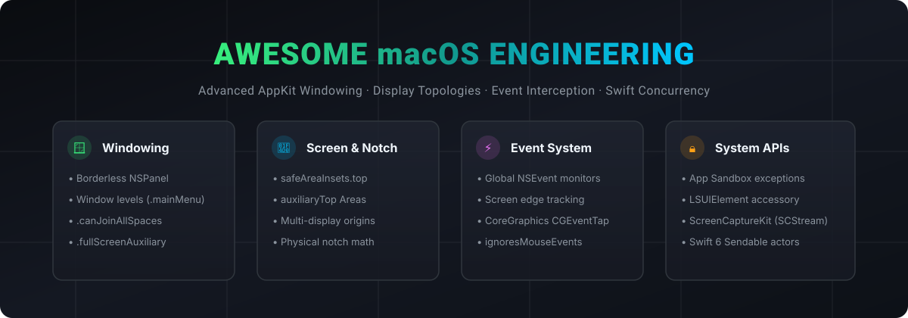

# Awesome macOS Engineering 🍏

A curated directory of advanced macOS engineering techniques, system windowing internals, notch & display geometry, AppKit/SwiftUI bridging, and developer utilities.

[](https://awesome.re)
[](LICENSE)
[](CONTRIBUTING.md)

<p align="center">
  
</p>

---

## 📑 Contents

- [Windowing & Panels](#-windowing--panels)
- [Notch & Display Metrics](#-notch--display-metrics)
- [Multi-Display Topologies & Virtual Workspaces](#-multi-display-topologies--virtual-workspaces)
- [Event Interception: NSEvent vs CGEventTap](#-event-interception-nsevent-vs-cgeventtap)
- [Menu Bar Architecture](#-menu-bar-architecture)
- [Hardware & System Introspection](#-hardware--system-introspection)
- [App Lifecycle & Sandbox Entitlements](#-app-lifecycle--sandbox-entitlements)
- [Swift Concurrency on Darwin](#-swift-concurrency-on-darwin)
- [Open Source macOS References](#-open-source-macos-references)
- [Contributing](#-contributing)

---

## 🪟 Windowing & Panels

Engineering non-activating, floating, and overlay windows requires deep AppKit mechanics:

- **Borderless NSPanel**: Create unobtrusive utility overlays using:
  ```swift
  let panel = NSPanel(
      contentRect: frame,
      styleMask: [.borderless, .nonactivatingPanel],
      backing: .buffered,
      defer: false
  )
  ```
- **Window Levels**:
  - `NSWindow.Level.normal` (Level 0) — Standard document windows.
  - `NSWindow.Level.floating` (Level 3) — Standard floating tool palette.
  - `NSWindow.Level.mainMenu + 1` (Level 25) — Overlays that float directly above the macOS Menu Bar.
  - `NSWindow.Level.screenSaver` (Level 1000) — Lock-screen visible surfaces.
- **Collection Behaviors**:
  - `.canJoinAllSpaces` — Persists across all Mission Control virtual spaces without reloading.
  - `.fullScreenAuxiliary` — Displays cleanly over native macOS full-screen applications.
  - `.stationary` — Excluded from Mission Control window exposés and window rearrangement.
  - `.ignoresCycle` — Excluded from Cmd+` window cycling.

---

## 📐 Notch & Display Metrics

Modern MacBook Pros (Apple Silicon 14" and 16") feature a hardware camera notch that introduces specific screen layout considerations:

- **`NSScreen.safeAreaInsets`**:
  ```swift
  guard let screen = NSScreen.main, screen.safeAreaInsets.top > 0 else {
      // Screen does not have a camera housing notch
      return
  }
  ```
- **Notch Dimensions Calculation**:
  When a notch is present, the top menu bar is split into two auxiliary areas:
  $$\text{Notch Width} = \text{Screen Width} - (\text{auxiliaryTopLeftArea.width} + \text{auxiliaryTopRightArea.width})$$
  $$\text{Notch Height} = \text{safeAreaInsets.top}$$
- **NotchKit Library**: [`swiftui-notch-kit`](https://github.com/nilkanthdesai76/swiftui-notch-kit) provides automatic hardware notch geometry, preview mockers, and SwiftUI environment keys.

---

## 🖥 Multi-Display Topologies & Virtual Workspaces

Handling multiple monitors on macOS differs significantly from iOS because the coordinate system is unified:

- **Primary Display Anchor**: The screen at `NSScreen.screens.first` contains the origin `(0, 0)` at its bottom-left corner.
- **Negative Coordinates**: Secondary screens arranged to the left or below the primary display will have negative coordinates (`origin.x < 0` or `origin.y < 0`).
- **Screen Rearrangement Notification**:
  Always listen for display configuration shifts to re-anchor overlay panels:
  ```swift
  NotificationCenter.default.publisher(for: NSApplication.didChangeScreenParametersNotification)
  ```

---

## ⚡️ Event Interception: NSEvent vs CGEventTap

Tracking hover, clicks, or gestures outside an application window:

| Mechanism | Permissions Required | Can Mutate/Drop Events? | Best Use Case |
| :--- | :--- | :--- | :--- |
| **`NSEvent.addLocalMonitorForEvents`** | None | Yes | App-internal keyboard shortcuts & mouse clicks |
| **`NSEvent.addGlobalMonitorForEvents`** | None (read-only) | No | Non-activating menu bars, notch hover detection |
| **`CGEventTap` (CoreGraphics)** | Accessibility (AX) | Yes | Global hotkey engines, window tiling managers |

**Tip for Notch & Edge Hovering**: Use `NSEvent.addGlobalMonitorForEvents(matching: [.mouseMoved])` paired with `panel.ignoresMouseEvents = true` when hidden, so the mouse pointer never blocks underlying macOS menu bar items.

---

## 🧭 Menu Bar Architecture

- **`NSStatusItem` vs SwiftUI `MenuBarExtra`**:
  - SwiftUI `MenuBarExtra` is great for simple text menus, but lacks custom window levels, mouse tracking outside borders, and fine-grained positioning.
  - Recommended Production Pattern: `NSStatusItem` button providing the anchor position + an independent borderless `NSPanel` hosting a SwiftUI `NSHostingView`.
- **Reference Implementation**: [`menubar-swiftui-template`](https://github.com/nilkanthdesai76/menubar-swiftui-template).

---

## 🔍 Hardware & System Introspection

- **`IOKit` & `SMC`**: Querying battery health, fan speeds, CPU thermal state, and power adapter wattage.
- **`ScreenCaptureKit` (`SCStream`)**: High-performance, zero-copy screen and audio capture with hardware acceleration on macOS 12.3+.
- **`AVFoundation` / `CoreMedia`**: Ultra-low-latency local camera previews (`AVCaptureSession`) using Continuity Camera and native FaceTime HD cameras.
- **`MediaRemoteAdapter`**: Reading system Now Playing metadata on macOS 15+ where private sandbox entitlements restrict direct framework calls.

---

## 🛡 App Lifecycle & Sandbox Entitlements

- **Accessory Apps (`LSUIElement`)**:
  - Set `LSUIElement = true` in `Info.plist` to build apps without a Dock icon.
  - Temporarily elevate to `.regular` activation policy using `NSApp.setActivationPolicy(.regular)` when presenting dedicated Settings or Preferences windows so the system menus function normally.
- **App Sandbox Exceptions**:
  - `com.apple.security.temporary-exception.shared-preference.read-only`
  - `com.apple.security.network.client` for outgoing API traffic.

---

## 🔒 Swift Concurrency on Darwin

- **`@MainActor` with AppKit**: All UI mutations (`NSWindow`, `NSView`, `NSStatusItem`, `NSScreen`) must remain strictly isolated to `@MainActor`.
- **Thread-Safe Data Structures**: When collecting system telemetry from concurrent background threads, use reader-writer barrier queues or actors: [`swift-concurrent-collections`](https://github.com/nilkanthdesai76/swift-concurrent-collections).
- **Rate-Limiting Events**: Prevent UI thrashing on high-frequency `mouseMoved` or sensor callbacks with [`swift-throttle-debounce`](https://github.com/nilkanthdesai76/swift-throttle-debounce).

---

## 🌟 Open Source macOS References

- [Rectangle](https://github.com/rxhanson/Rectangle) — Window management app written in Swift.
- [Ice](https://github.com/jordanbaird/Ice) — Powerful menu bar manager for macOS.
- [MonitorControl](https://github.com/MonitorControl/MonitorControl) — Controls external monitor brightness & volume.
- [Stats](https://github.com/exelban/stats) — macOS system monitor in your menu bar.
- [swiftui-notch-kit](https://github.com/nilkanthdesai76/swiftui-notch-kit) — MacBook notch geometry and safe-area toolkit.
- [menubar-swiftui-template](https://github.com/nilkanthdesai76/menubar-swiftui-template) — Production menu bar extra starter template.

---

## 🤝 Contributing

Contributions, fixes, and recommendations are welcome! Please submit a pull request or open an issue.

## 📄 License

Dedicated to the public domain under [Creative Commons Zero (CC0 1.0)](LICENSE).
